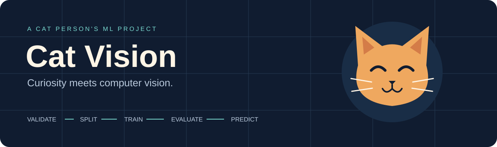
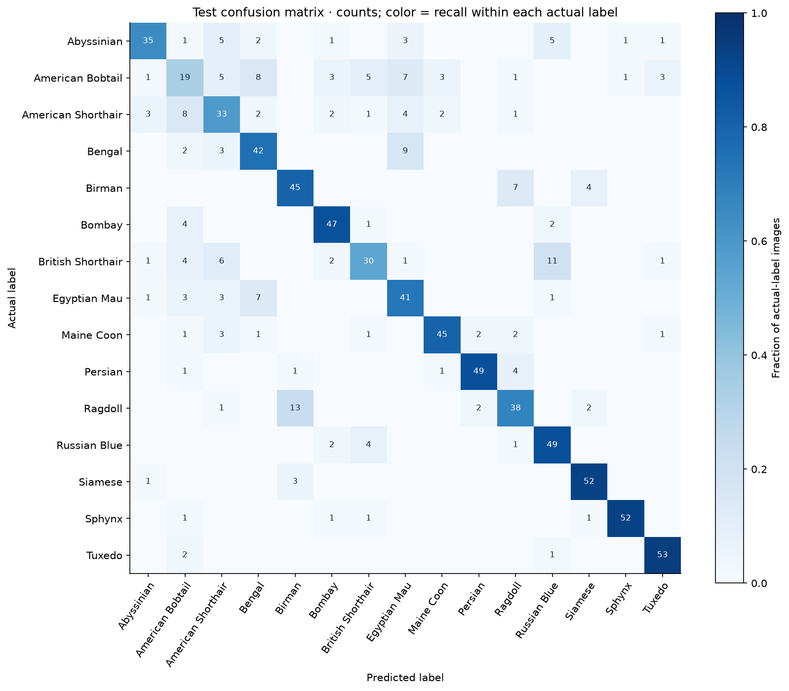

<p align="center">
  
</p>

<p align="center">
  <a href="https://github.com/stefisha/Cat-Vision/actions/workflows/ci.yml"></a>
  
  
  <a href="LICENSE"></a>
</p>

I like cats. I also like understanding what a model has actually learned. **Cat Vision** brings those interests together: a reproducible MobileNetV2 project that classifies cat photos into the Gano collection's 15 labels.

It started as a Colab notebook. It now includes audited data groups, traceable training runs, a validation-based experiment comparison, and measured held-out results. **Tuxedo is a coat pattern, not a breed**; the source taxonomy is retained and its limits are explicit.

## Measured results

The selected recipe, **frozen-horizontal-flip**, was chosen using validation data before evaluating its checkpoint on **836 held-out images**.

| Test metric | Result |
| --- | --- |
| Accuracy | **75.4%** |
| Macro F1 | **0.751** |
| Top-3 accuracy | 93.7% |
| Training-majority baseline accuracy | 6.7% |
| 95% accuracy interval | 72.5%–78.0% |

[Read the complete experiment](docs/results/gano-v3/README.md) for validation comparisons, per-label metrics, data audit, uncertainty, hardware, hashes and limitations.



This is one seed on an audited within-collection split. It does not establish performance on arbitrary phone photos or unfamiliar breeds. The original notebook's **88.16% training accuracy** had no holdout and is not directly comparable with these test results. Dataset images and trained weights are not distributed in the repository.

## What is here

- **Data audit:** decode checks, SHA-256 deduplication, reviewed perceptual-similarity candidates, filename-ID groups and persisted group-disjoint splits.
- **Training:** frozen or partially fine-tuned MobileNetV2, optional horizontal flips, embedded normalization, validation-loss checkpoint selection and parent-checkpoint tracing.
- **Evaluation:** accuracy, macro F1, top-3, per-label scores, confusion matrix, log loss, majority baseline and group-bootstrap uncertainty intervals.
- **Reports:** standalone offline HTML, scientific plots, score-reliability diagnostics and an optional local photo error gallery.
- **Reproducibility:** pinned source archive, committed manifest/decisions/configs, model/data hashes, locked dependencies and Git/environment provenance.
- **Quality:** packaged CLI, synthetic regression tests, and Linux CI with no dataset credentials or pretrained download.

## Quick start

Use **Python 3.11** for the tested environment. Python 3.12 is allowed but is not yet in CI. Targets are Linux x86-64 and Apple Silicon macOS 12+. Intel macOS is not supported by this TensorFlow pin; use Linux or Colab. A GPU is optional; the measured study ran on CPU. See [TensorFlow installation](https://www.tensorflow.org/install/pip) for accelerator setup.

```bash
git clone https://github.com/stefisha/Cat-Vision.git
cd Cat-Vision
python3.11 -m venv .venv
source .venv/bin/activate  # Windows PowerShell: .venv\Scripts\Activate.ps1
python -m pip install --upgrade pip
python -m pip install -e '.[ml,report,dev]'
cat-vision --help
```

For the fully resolved environment, use [uv](https://docs.astral.sh/uv/): `uv sync --frozen --extra ml --extra report --extra dev`, then run commands with `uv run --no-sync`. Direct versions and all resolved transitive versions are committed. CI uses the frozen lockfile.

### 1. Fetch the pinned collection

```bash
python scripts/fetch_gano.py
```

This downloads Kaggle version 3, checks its SHA-256 and safely extracts it into `data/raw/Gano-Cat-Breeds-V1_1/`. The source page states CC BY-SA 4.0; see the [source record](docs/results/gano-v3/source.json) and [data guide](docs/data.md). Raw photos, credentials and generated models stay outside Git.

For a different collection, arrange images under immediate label folders and supply the root with `--data-dir`. Each class needs at least three unique valid images; this minimum supports tests, not a credible performance estimate.

### 2. Audit and freeze split membership

```bash
cat-vision audit \
  --data-dir data/raw/Gano-Cat-Breeds-V1_1 \
  --decisions docs/results/gano-v3/review-decisions.json \
  --output data/audits/gano-v3.json

cat-vision prepare \
  --data-dir data/raw/Gano-Cat-Breeds-V1_1 \
  --audit data/audits/gano-v3.json \
  --manifest data/manifests/gano-v3.json
```

The measured split retains **5,573 images: 3,896 train / 841 validation / 836 test**. It removes 52 redundant exact files and keeps reviewed photo-copy/filename-ID groups together. The committed [manifest](docs/results/gano-v3/manifest.json) is the exact experiment membership; regenerated membership should match it. Near-duplicate screening does not establish complete animal identity independence.

### 3. Train the selected baseline

This quick start uses the published selected recipe. The experiment guide reproduces the full comparison.

```bash
cat-vision train \
  --data-dir data/raw/Gano-Cat-Breeds-V1_1 \
  --manifest docs/results/gano-v3/manifest.json \
  --config configs/frozen-horizontal-flip.json \
  --run-dir runs/gano-v3/frozen-horizontal-flip
```

`--config` is explicit. The first run downloads ImageNet weights; validation loss selects `model.keras`. Existing run destinations are never silently overwritten. Follow [the experiment guide](docs/experiments.md) to repeat the three-recipe comparison and validation-only selection.

### 4. Evaluate the selected run and generate a report

```bash
cat-vision evaluate \
  --data-dir data/raw/Gano-Cat-Breeds-V1_1 \
  --run-dir runs/gano-v3/frozen-horizontal-flip

cat-vision report --run-dir runs/gano-v3/frozen-horizontal-flip
```

Open the run's `test-report/index.html` offline. It includes learning curves, confusion counts, per-label recall, a reliability diagram and confident-error records. To embed local photo thumbnails, add `--data-dir ... --include-images`; photos are omitted by default and nothing is uploaded. Review image rights before sharing a report with embedded photos.

### 5. Try your cat

```bash
cat-vision predict \
  --run-dir runs/gano-v3/frozen-horizontal-flip \
  --image /path/to/your/cat.jpg \
  --top-k 3
```

Scores rank known labels; they are not calibrated probabilities of ancestry. There is no unknown/non-cat detector. See the [model card](docs/model-card.md).

## Project map

```text
src/cat_vision/       Audit, data contracts, model, training, metrics, reports, CLI
configs/             The three planned experiment recipes and original baseline
scripts/             Checksum-pinned dataset acquisition
notebooks/           Original exploratory experiment (historical)
tests/               Synthetic data, training, reporting and provenance regressions
docs/results/        Measured evidence, manifest, audit decisions and figures
.github/             CI and contribution templates
uv.lock              Full resolved dependency versions
```

## Development

```bash
ruff check .
ruff format --check .
pytest -q
```

Tests use generated images and random model weights; no Kaggle access or ImageNet download is needed. Install `.[dev,report]` and run `pytest -m 'not ml' -q` for the lightweight subset without TensorFlow. Passing software tests is not evidence of recognition accuracy.

Read [CONTRIBUTING.md](CONTRIBUTING.md), [architecture](docs/architecture.md), and the [verification record](docs/verification.md).

## Next questions

1. How well does the selected model work on an independent set of real phone photos?
2. How stable are results across training seeds and more complete animal-identity groups?
3. Can calibrated scores and unknown/non-cat examples support a useful “unsure” response?
4. Can a small upload demo explain the model's predictions and limits clearly?

## Credits and license

Dataset: [ShawnGano / Olivia Gano's Gano Cat Breed Image Collection](https://www.kaggle.com/datasets/shawngano/gano-cat-breed-image-collection). Backbone: [MobileNetV2](https://arxiv.org/abs/1801.04381), via [Keras Applications](https://www.tensorflow.org/api_docs/python/tf/keras/applications/MobileNetV2). Original experiment: [historical notebook](notebooks/original_experiment.ipynb).

Code and repository artwork use the [MIT license](LICENSE). Dataset photos and third-party weights retain their own terms. This project does not establish ancestry or support health, care, breeding or pedigree decisions.
