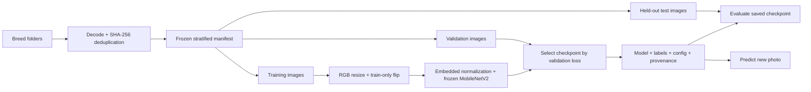

# Architecture and decisions

## A small pipeline with explicit boundaries

`data.py` owns image decoding and manifest integrity. `model.py` owns the serialized network. `pipeline.py` connects those contracts to training and reporting. `cli.py` parses commands and reports actionable errors. Data preparation works without importing TensorFlow.

## Why these choices?

| Decision | Reason | Tradeoff |
| --- | --- | --- |
| Frozen MobileNetV2 | Small, understandable transfer-learning baseline; continues the original experiment | Fine-tuning may perform better, but must be measured |
| Global average pooling + dropout + softmax | Fewer head parameters than the original 256-unit dense head | Different model; historical accuracy is not directly comparable |
| Embedded `Rescaling(1/127.5, offset=-1)` | MobileNetV2 expects pixels scaled from 0–255 to -1–1; the saved model carries normalization | Callers must supply RGB pixels on the 0–255 scale |
| Shared Pillow RGB/EXIF/resize function | Same image semantics for train, test, and prediction, including GIF first frames | Python-backed decoding prioritizes shared semantics over maximum input throughput |
| Sorted labels in the manifest | Output index has one persisted meaning | Changing the label set requires a new run |
| SHA-256 manifest and per-image hashes | Detect accidental dataset drift and exact duplicates | Does not detect visually similar photos or identify the same animal |
| Per-class seeded split | Every supported class has examples in each partition | Source/animal groups need a future group-aware split |
| Validation-loss checkpoint | Select a model using validation evidence rather than training accuracy | Validation can still be overused during repeated experimentation |
| `.keras` run bundle | Straightforward round-trip with Keras 3 | Load only artifacts from a trusted source |
| Local artifacts and JSON config | Inspectable experiments without a service dependency | No experiment server or distributed execution |
| TensorFlow 2.21.0 + Python 3.11 baseline | Explicit, tested dependency baseline rather than an unbounded latest install | Periodic dependency updates need CI validation |

MobileNetV2 normalization follows the [official TensorFlow contract](https://www.tensorflow.org/api_docs/python/tf/keras/applications/MobileNetV2). EXIF correction and resizing happen before the network and are shared Python code; they are not part of the `.keras` graph. The graph embeds augmentation (active in training only) and normalization.

## Reproducibility boundaries

The manifest records relative paths, labels, content hashes, and split membership. A run copies it alongside configuration, class order, installed versions, Git revision and working-tree status. Completed runs fingerprint the configuration and checkpoint too; loading a run checks these fingerprints and the label order. Fixed seeds and TensorFlow deterministic operations reduce variability. They do not guarantee identical floating-point results across hardware, TensorFlow builds, or operating systems.

The canonical environment is in `uv.lock`; a run's provenance records what actually executed. The source Git revision and dirty flag are captured before creating the run directory, so the run’s own outputs cannot change the recorded starting state. A dirty Git tree is recorded explicitly because a revision alone cannot reconstruct uncommitted code. Commit code before collecting portfolio results.

## Scope

There is no API server, container stack, model registry, or production deployment here. The CLI and run bundles cover the current task. Add infrastructure when an actual deployment needs it, and keep ML evaluation evidence separate from application polish.
