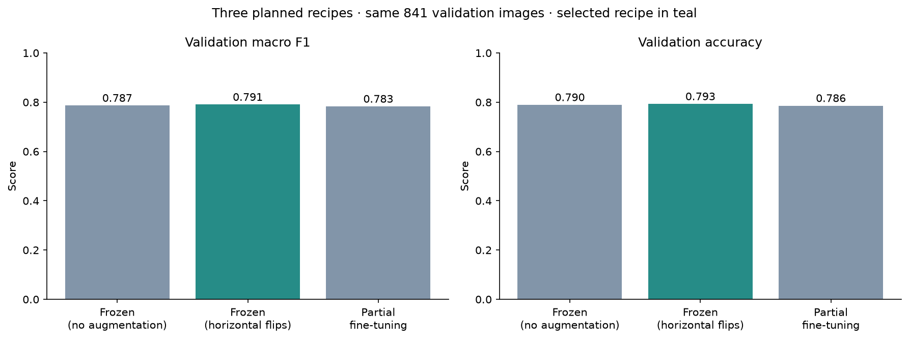
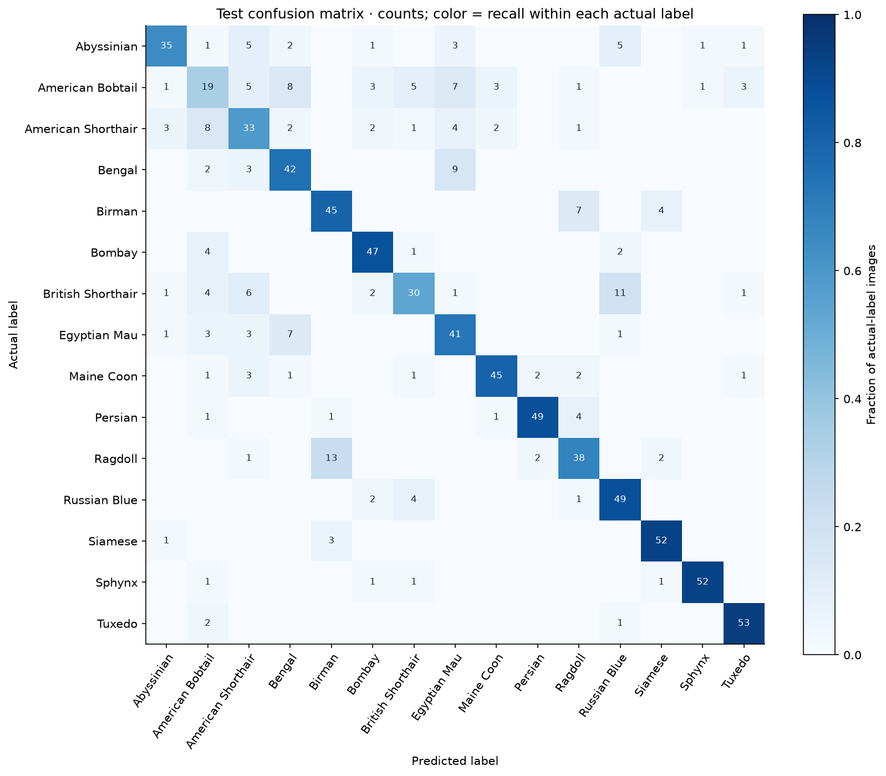
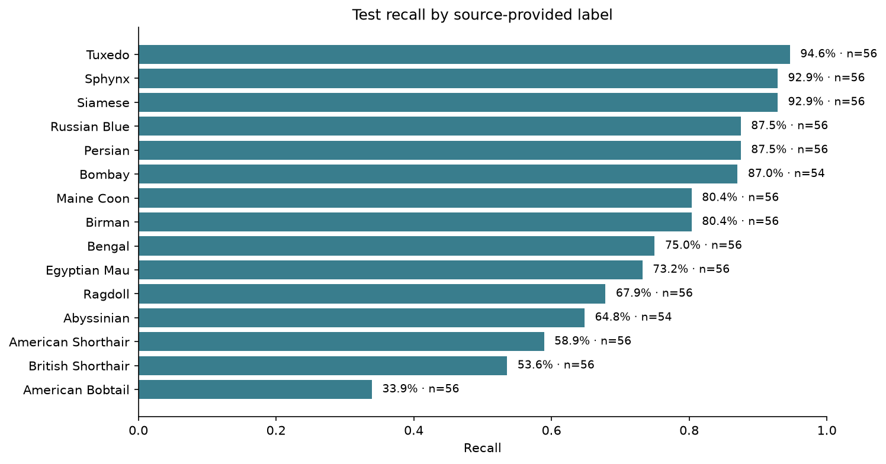
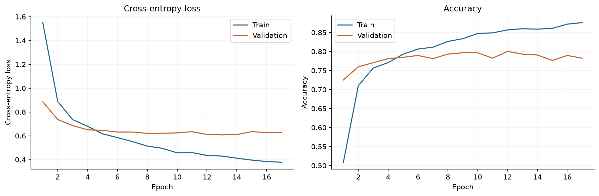
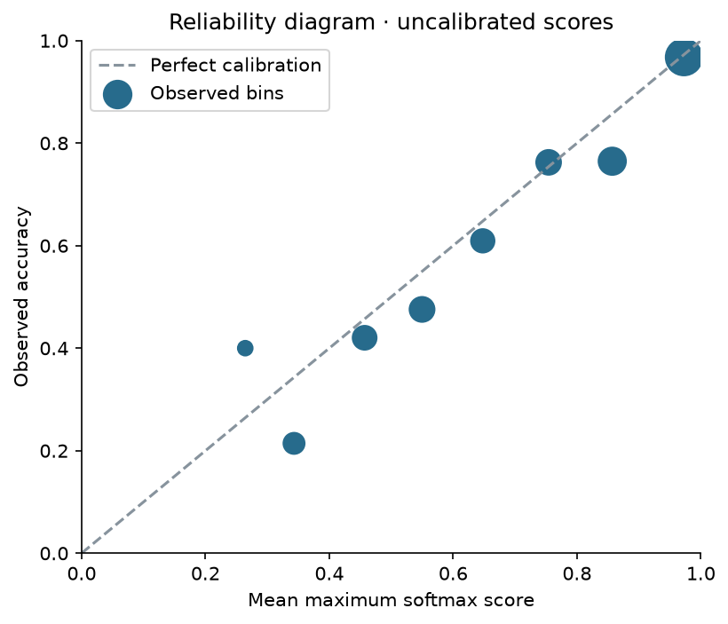

# Gano v3 · first measured experiment

Recorded on **2026-11-03 (Europe/Belgrade)**. This is one seed, three planned recipes, and a final evaluation of one validation-selected checkpoint. [The experiment plan](../../experiment-plan.md) was committed before training; it was not revised to chase a test result.

## Data and audit

The pinned collection contains 5,625 files. Current Pillow decoding accepted all of them. Removing 52 redundant exact files leaves **5,573 images**. Visual review approved 28 of 29 additional similarity pairs; the rejected candidate was a false match. Connected photo-copy and filename-ID groups stay in one partition. The final split is **3,896 train / 841 validation / 836 test**.

The dataset has 15 source-provided labels; Tuxedo is a coat pattern. Sources, checksum, stated collection license and attribution are in [source.json](source.json). [Audit decisions](review-decisions.json), [audit summary](audit-summary.json), [split counts](split-counts.csv) and the complete [manifest](manifest.json) are committed. Rerunning audit and preparation reproduced the exact manifest fingerprint `4e137af8a4f0a9e4a0c121602719f51bf71cc9d57f5263848e407e55f06b2abb`.

## Validation comparison

Within each run, minimum validation loss selected the checkpoint. Across the three saved checkpoints, maximum validation macro F1 selected **frozen-horizontal-flip**. The [selection record](selection.json) was written before computing test predictions and records checkpoint and validation-metrics hashes.

| Recipe | Validation accuracy | Validation macro F1 | Validation log loss | Best epoch | Training time |
| --- | --- | --- | --- | --- | --- |
| frozen-no-augmentation | 79.0% | 0.787 | 0.617 | 12 | 7.9 min |
| frozen-horizontal-flip | 79.3% | 0.791 | 0.608 | 13 | 10.2 min |
| partial-fine-tuning | 78.6% | 0.783 | 0.630 | 4 | 3.4 min |

Horizontal flips changed validation macro F1 by **+0.0039** against the no-augmentation baseline. Partial fine-tuning reached **92.8% training accuracy**, but its best-loss checkpoint had lower validation macro F1 than either frozen recipe. Increasing trainable parameters from 19,215 to 1,060,495 did not improve the planned selection metric in this run. We kept the validation-selected frozen model.

This is a small, fixed, single-seed comparison. Differences are descriptive and are not evidence of statistically significant or seed-stable improvement. The unselected checkpoints were not evaluated on test. Per-recipe configuration, history, provenance and validation metrics are under [candidates/](candidates/).

## Selected model: held-out test

| Metric | Result |
| --- | --- |
| Accuracy | **75.4%** |
| Macro F1 | **0.751** |
| Top-3 accuracy | 93.7% |
| Log loss | 0.717 |
| Training-majority baseline accuracy | 6.7% |
| 95% accuracy interval | 72.5%–78.0% |
| 95% macro F1 interval | 0.722–0.777 |

Intervals are from 2,000 seeded class-stratified group-bootstrap samples. They cover held-out sampling variation conditional on observed labels/groups, not training seeds, missed animal identities, annotation errors or population shift. [Machine-readable metrics](metrics.json) and [per-image predictions](test_predictions.json) contain the exact values; [per-label CSV](per-label-metrics.csv) supports further analysis.

| Source-provided label | Precision | Recall | F1 | Test support |
| --- | --- | --- | --- | --- |
| Abyssinian | 83.3% | 64.8% | 0.729 | 54 |
| American Bobtail | 41.3% | 33.9% | 0.373 | 56 |
| American Shorthair | 55.9% | 58.9% | 0.574 | 56 |
| Bengal | 67.7% | 75.0% | 0.712 | 56 |
| Birman | 72.6% | 80.4% | 0.763 | 56 |
| Bombay | 81.0% | 87.0% | 0.839 | 54 |
| British Shorthair | 69.8% | 53.6% | 0.606 | 56 |
| Egyptian Mau | 63.1% | 73.2% | 0.678 | 56 |
| Maine Coon | 88.2% | 80.4% | 0.841 | 56 |
| Persian | 92.5% | 87.5% | 0.899 | 56 |
| Ragdoll | 70.4% | 67.9% | 0.691 | 56 |
| Russian Blue | 71.0% | 87.5% | 0.784 | 56 |
| Siamese | 88.1% | 92.9% | 0.904 | 56 |
| Sphynx | 96.3% | 92.9% | 0.945 | 56 |
| Tuxedo | 89.8% | 94.6% | 0.922 | 56 |

## Error analysis

The largest directional confusions in the selected model's test matrix are shown below, including every pair tied at the cutoff of 7 images:

| Actual source label | Predicted label | Images |
| --- | --- | --- |
| Ragdoll | Birman | 13 |
| British Shorthair | Russian Blue | 11 |
| Bengal | Egyptian Mau | 9 |
| American Bobtail | Bengal | 8 |
| American Shorthair | American Bobtail | 8 |
| American Bobtail | Egyptian Mau | 7 |
| Birman | Ragdoll | 7 |
| Egyptian Mau | Bengal | 7 |

These are observed annotation disagreements, not proof that the model or the source label is biologically correct. Similar appearance, framing, source artifacts and noisy labels are hypotheses for follow-up inspection, not causes established by this experiment. Error analysis was performed after selection and was not used to modify these recipes.

The offline report includes the twelve most confident mistakes. Recreate it with `cat-vision report --run-dir runs/gano-v3/frozen-horizontal-flip`. Add `--data-dir data/raw/Gano-Cat-Breeds-V1_1 --include-images` for local photo thumbnails. Photos are omitted from public repository evidence. [Source breakdown](source-breakdown.json) is descriptive only: source groups have different label mixtures and very small Google support, so it is not a controlled domain comparison.

## Runtime and provenance

Training ran on Apple Silicon CPU. The inference benchmark used explicit TensorFlow intra-op/inter-op thread settings 6/1; those settings are not recorded in the historical training provenance. The selected model checkpoint is 9.4 MiB. In one warm-model session, decode/resize plus batch-one inference had median **39.4 ms** and p95 **40.9 ms**, measured on 50 evenly spaced validation images after five warmups. This excludes process startup/model loading and is not a hosted-service latency guarantee. Details: [runtime.json](runtime.json).

Selected training revision: `389291d4b963ffccc78738fd3e6410b43f839347`; dirty at start: `False`. [Full model provenance](model-provenance.json) records Python, packages, platform/devices, parameter count, hashes and timing. [Selected config](model-config.json) and [classes](classes.json) complete the public record. The core training/evaluation code is unchanged across the candidate revisions; intermediate commits add reports, selection tooling and tests.

The model bundle remains local rather than a public weight release. Reproduction commands are in [the experiment guide](../../experiments.md). The original notebook's 88.16% training accuracy used a different head and no holdout, and is not directly comparable with these scores.

## What remains unmeasured

No independent phone-photo benchmark, seed sweep, exhaustive animal-identity audit, unknown/non-cat rejection evaluation or calibration treatment has been completed. The source taxonomy and label noise limit what this study can establish. Test images should now be treated as observed evaluation evidence; any model changes informed by them need a fresh independent final holdout.
